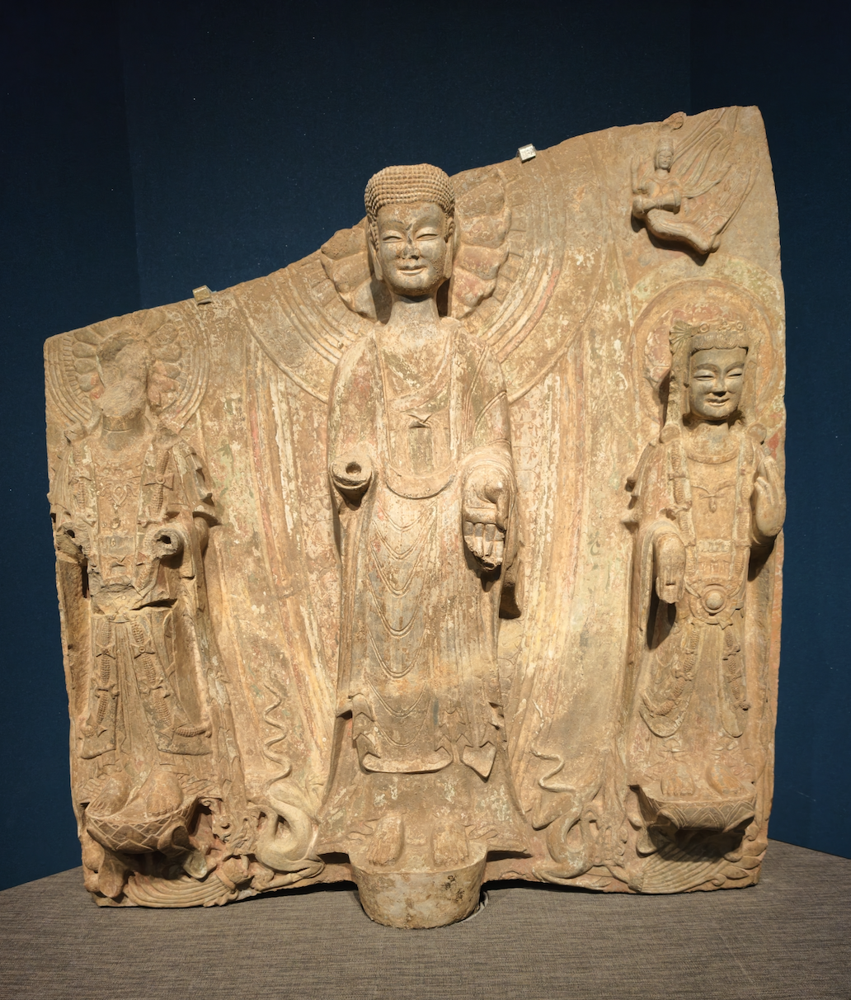
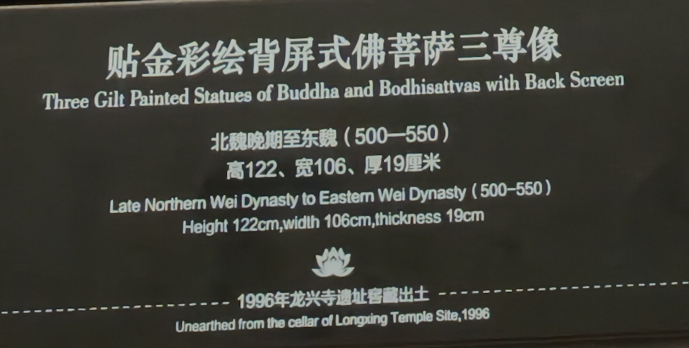
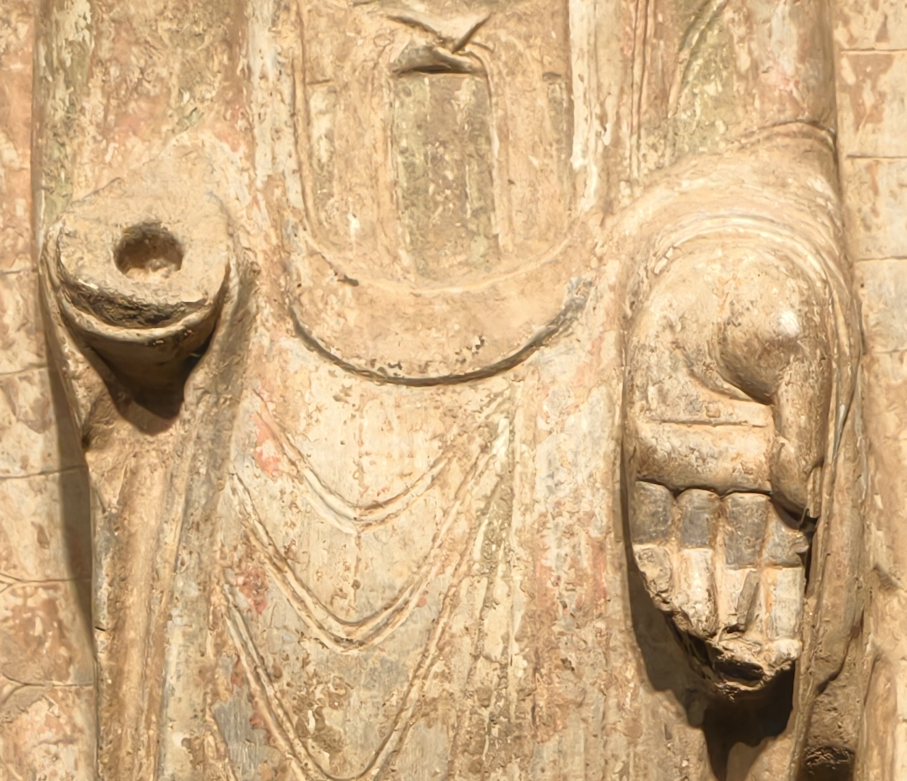
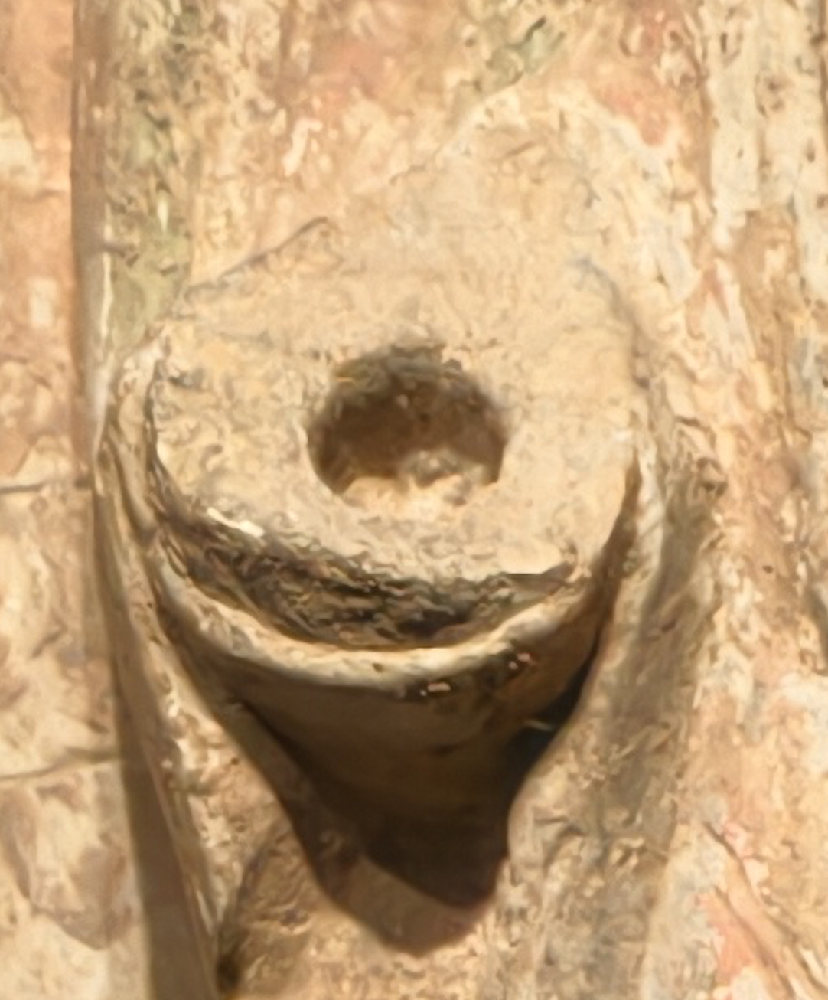
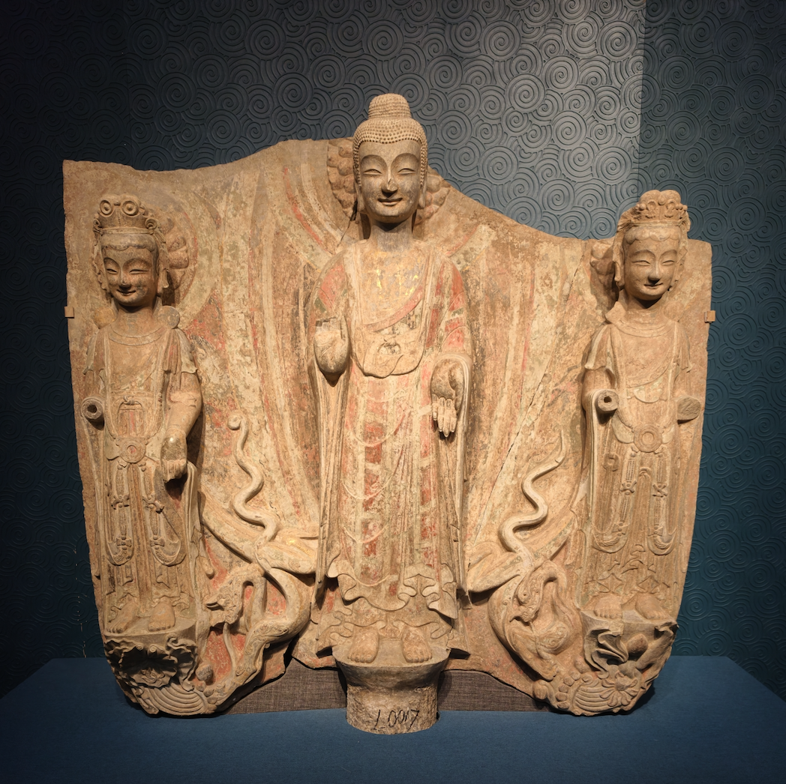
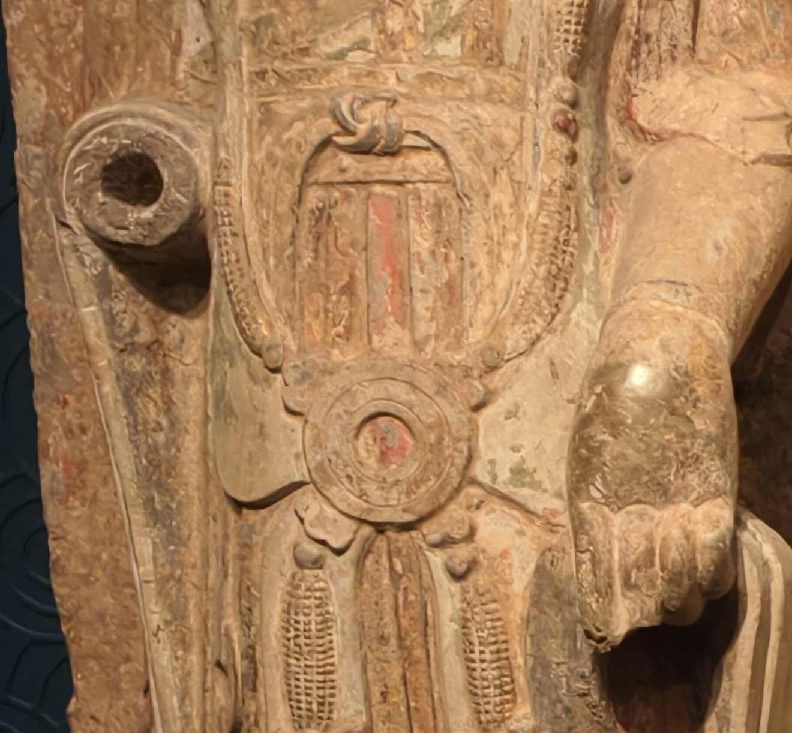
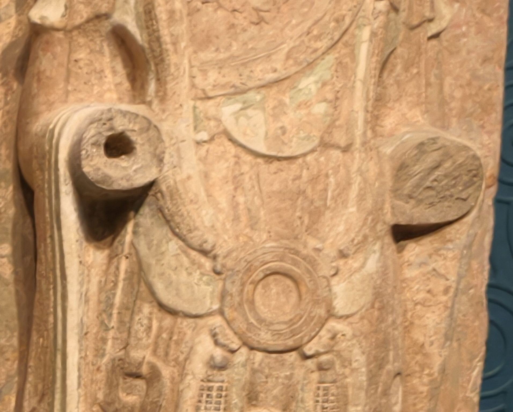
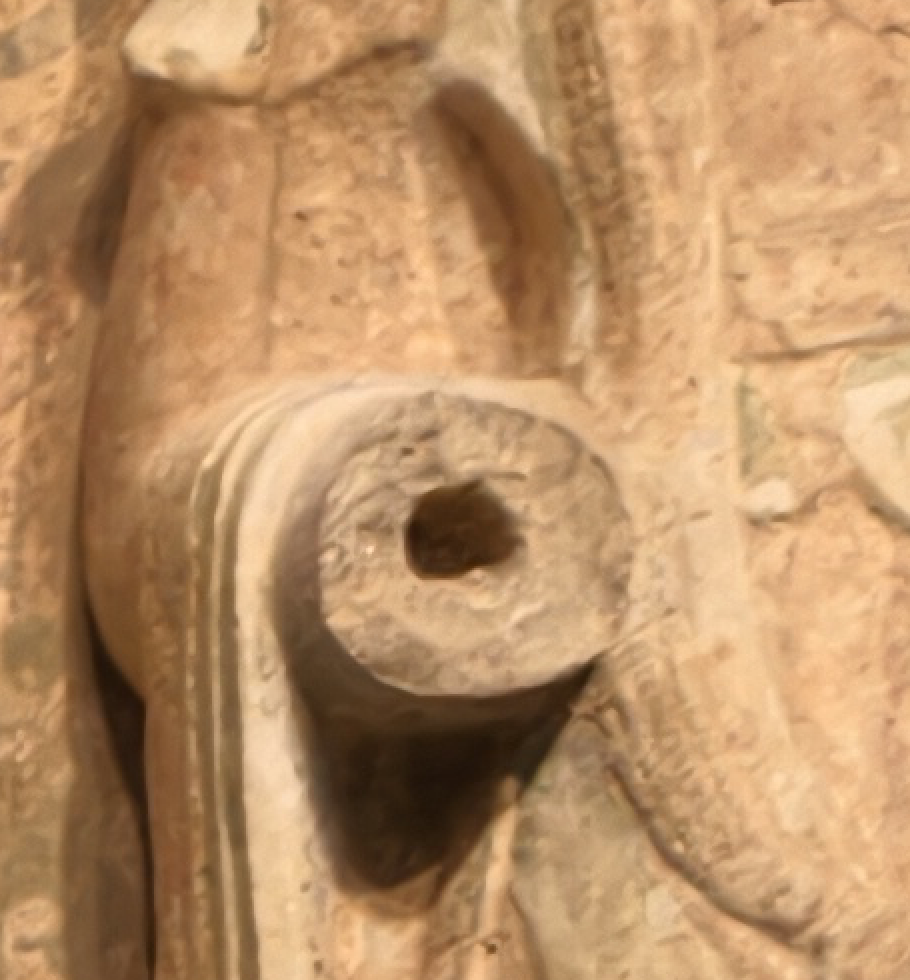
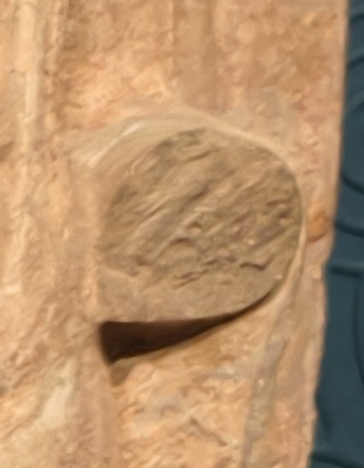

# 由青州两件背屏三尊造像引出的观察札记
## ——断臂、卯孔与二次破坏

> 这不是一篇试图盖棺定论的论文，而是一次从实物痕迹出发的推敲记录。能从照片中直接看到的，尽量只说观察；由观察推出来的，标明是推断；现有材料还回答不了的，就把问题留下。

青州博物馆展厅里，一件北魏晚期至东魏的贴金彩绘背屏式佛菩萨三尊像，主尊一侧手臂完整，另一侧只剩带圆孔的残端。常见解说容易把这种圆孔理解为“原先预留的插榫”，仿佛手臂从一开始就是单独制作、插接上去的。

但同一件造像上，完整手臂与带孔断臂同时存在；另一件背屏三尊像上，同一胁侍的两处断面又呈现一处有孔、一处无孔。把这些痕迹放在一起看，圆孔背后显现的可能不是一种单纯的装配方式，而是一段由制作、断裂、修补、再次破坏直至入藏组成的连续历史。

本文器物照片均由作者摄于青州博物馆。

---

## 一、第一件造像：先看全貌，不急着看孔

第一件观察对象是青州博物馆所藏贴金彩绘背屏式佛菩萨三尊像。展牌标注其年代为北魏晚期至东魏（500—550），高122厘米、宽106厘米、厚19厘米，1996年出土于龙兴寺遗址窖藏。

*图1　贴金彩绘背屏式佛菩萨三尊像全貌。主尊观者左侧手臂残断并见圆孔，观者右侧手臂仍然保留。*

*图2　青州博物馆展牌：北魏晚期至东魏（500—550），高122厘米、宽106厘米、厚19厘米，1996年龙兴寺遗址窖藏出土。*

从全貌看，这不是一尊脱离背景独立站立的圆雕，而是主尊、胁侍、背屏、衣纹与装饰共同组织在一块石体上的高浮雕造像。理解手臂的结构，首先要把它放回这套背屏浮雕系统，而不是孤立地盯着一个孔。

---

## 二、同器对照：完整手臂是最重要的内部参照

主尊双臂局部把问题摆得很清楚：观者左侧为带圆孔的断臂，观者右侧仍保存从肩臂到手掌的连续形体。

*图3　主尊双臂局部。观者左侧为带圆孔的断臂；观者右侧保留完整手臂，可作为判断原生结构的同器参照。*

从正面照片可观察到，完整侧的袈裟衣纹由躯干向手臂连续过渡，手臂下方又与衣纹、背屏石体形成支撑关系，照片中看不到明确的拼接界线。手掌虽有局部残损，但肩、肘、前臂和衣纹仍组成一条连续的雕刻关系。

这至少支持一个较强判断：**这件造像的基本制作逻辑是一体高浮雕，而不是双臂都预先做成可拆卸构件。**

它还不能仅凭一张正面照片证明每一寸石体都绝无拼接，更不能排除某一侧在制作过程中发生意外后被补接；但它足以让“左右双臂原本都是规则预制插接件”的说法变得很难成立。若那是原生设计，通常应当在对称部位看到相近的分割逻辑，而不是一侧连续、一侧带孔残断。

---

## 三、圆孔说明了什么，又不能说明什么

带孔一侧的近照显示，孔位于手臂残端中央附近。孔缘和周围断面并不是一块完整保存、边界清楚的规则装配面，而带有残破与崩裂。

*图4　主尊观者左侧断臂与圆孔细部。判断孔的性质，不能只看“有没有孔”，还要观察孔缘、断面、衣纹和彩绘层之间的时序关系。*

一个圆孔本身，只能直接证明这里曾经被钻凿；它不能单独告诉我们钻孔发生在造像制作之初、使用中的修复阶段，还是更晚的其他处理阶段。

结合完整侧手臂所显示的一体浮雕结构，较合理的解释是：带孔一侧曾经发生断裂，随后工匠在残端凿孔，以销、榫或金属灌固方式补接手臂。青州龙兴寺窖藏其他造像确有大量修补孔洞及铅锡合金遗存，说明“断后补接”并不是孤立现象。

但这里必须修正一个容易说得过满的判断：修复工匠为了贴合构件，可能会对断面进行局部錾修，却未必把整个断面磨成现代机械意义上的平整圆盘。反过来，今天看到的粗糙孔缘，也不能证明这里从未被修整——后来的再次破坏，完全可能把早期修整面一起崩掉。

因此，现有照片最适合支持的是“修复卯”的高概率判断，而不是“孔缘粗糙本身就证明经历过二次破坏”的单一结论。

---

## 四、一条更谨慎的时序链

把第一件造像的痕迹按时间排列，可以得到一条较为节制的推演：

1. **原生制作**：主尊手臂采用背屏式一体高浮雕结构，衣纹与背屏石体同时承担视觉和结构作用。
2. **早期断裂**：观者左侧手臂在制作、搬运或供奉期间发生断裂。仅凭现有照片，尚不能确定具体发生在何时。
3. **补接修复**：工匠在断臂处凿孔，安装补配手臂，并可能使用金属、灰浆或其他介质固定。
4. **继续使用**：修复后的造像重新进入供奉或陈置状态；龙兴寺造像中存在后世重妆现象，说明部分造像经历了较长的修补与再使用过程。
5. **最终破坏**：补配手臂再次脱失，孔缘及早期接合面可能同时崩坏。造像其他部位也遭到不同程度的击损。
6. **窖藏**：最终暴露的断面未再获得完整修复，造像随后进入窖藏。

其中，第1、3、6步有较强的同器结构和同类考古材料支持；第2步发生的具体阶段，以及第5步究竟是暴力击毁、搬运损伤还是接口自然失效，仍需更近距离的痕迹观察才能区分。

---

## 五、第二件造像：问题不再只是“一边完整、一边有孔”

第二件背屏三尊像让这个问题变得更有意思。它同样采用主尊居中、胁侍分列两侧的背屏式结构，多处手臂保存状态不同：有完整手掌，也有带孔残端，还有不带孔的实体断面。

*图5　第二件背屏三尊像全貌。两侧胁侍保留了完整手、带孔断臂和无孔断臂等不同状态，为同器比较提供了条件。*

主尊右侧、也就是观者左侧的胁侍，一臂残断并见圆孔，另一只下垂手仍然保留。完整手与躯干、衣纹和身侧石体相连，带孔一侧则只剩残端。

*图6　主尊右侧（观者左侧）胁侍局部：一侧为带圆孔的断臂，另一侧下垂手仍然保存。*

这再次说明，在背屏式造像内部，手臂并不天然等于“可拆卸构件”。同一人物的一只手可以保持连续的一体雕刻关系，另一只手却因历史中的断裂与补修而留下孔洞。

---

## 六、同一胁侍上的有孔与无孔断面

最有价值的内部对照，来自主尊左侧、也就是观者右侧的胁侍。它的双臂均已残断，但两个断面的状态不同：靠近主尊一侧的残端中央有孔，外侧残端则是没有孔的实体断面。

*图7　主尊左侧（观者右侧）胁侍双臂残端：靠主尊一侧断面中央见孔，外侧为无孔实体断面。*

*图8　同一胁侍的带孔断面。孔周围现存表面粗糙，未保留一块边界完整的规则接合面。*

*图9　同一胁侍的无孔实体断面。表面可见斜向纹理，但仅凭照片尚不能确定是石材断裂纹、人工錾痕还是后期清理痕迹。*

这组对照很难用“所有手臂原本都按同一方式预制插接”来解释。如果圆孔只是统一的原生装配设计，同一人物两臂的接口通常应具有某种对应关系；而这里一处有孔、一处无孔，更像两条不同的损伤史叠加在同一人物身上。

目前最有解释力的假说是：

- 带孔手臂曾较早断裂，随后被凿孔补接；
- 无孔手臂此前未必修复，直到最后一次破坏时才从实体石材处折断；
- 最终破坏时，修复过的手臂在原修复节点附近再次失效，而另一臂在没有旧孔的位置直接断开；
- 两处最终暴露面此后都没有再接受完整修复，随整件造像进入窖藏。

这可以解释为什么同一胁侍会同时留下“有孔”和“无孔”两种残面，也解释了为什么带孔断面今天看起来并不规整：我们所见的可能不是第一次修复时完整的接合面，而是最后一次破坏后留下的表面。

不过还存在另一个不能排除的可能：早期工匠直接在较粗糙的断面上钻孔，用填充材料弥合不规则接触面；后来补臂脱落，却没有发生大范围二次崩边。要区分这两种情况，必须进一步观察孔壁加工痕、孔内金属或灰浆残留，以及断面上的彩绘叠压关系。

---

## 七、从两件造像得到的三组内部对照

两件造像最重要的价值，不是又增加了几个带孔残臂，而是提供了三组可以互相校验的内部对照：

### 1. 同一主尊：完整臂与带孔断臂

完整侧显示一体高浮雕的结构逻辑；带孔侧更可能是在这个原生结构发生破损后介入的修复。

### 2. 同一胁侍：完整手与带孔断臂

同一人物的两臂并非天然都以分体方式制造，圆孔不能脱离另一只完整手的结构背景单独解释。

### 3. 同一胁侍：有孔断面与无孔断面

两种断面并存，说明不同手臂可能经历了不同的断裂与修复过程。孔是历史事件留下的痕迹，不一定是原生设计的统一构件。

同器对照的好处，在于材质、时代、工坊传统、埋藏环境大体相同，减少了拿不同时代、不同类型造像强行类比所带来的变量。

---

## 八、观察、推断与尚不能确认的边界

为了避免把一篇观察札记写成武断结论，可以把现阶段认识分为三层。

### 可以直接观察

- 第一件造像主尊观者左侧断臂有孔，观者右侧手臂保存；
- 第二件造像多处手臂状态不同，既有完整手，也有带孔和无孔断面；
- 主尊左侧（观者右侧）胁侍的两处断面，一处有孔、一处无孔；
- 多处当前暴露面并未呈现边界完整、规则一致的装配基面。

### 较强推断

- 这类背屏式造像以同石一体高浮雕为基本结构逻辑；
- 至少部分圆孔与断裂后的补接修复有关，而非全部属于原生预制装配；
- 有孔与无孔断面并存，记录了不同的损伤和修复经历；
- 部分带孔位置可能在修复后再次受损，早期接合面的完整形态已被破坏。

### 仍待验证

- 第一次断裂发生在雕刻过程中，还是供奉使用期间；
- 当前粗糙断面是二次崩裂面，还是未经充分整平的原修复面；
- 孔内是否仍有铅锡、铁销、石灰或其他固定介质；
- 彩绘是否跨越原接合处，能否据此判断修复与重妆的先后；
- 各次破坏与北周法难、后世毁损及最终窖藏之间能否建立更精确的年代对应。

---

## 九、为什么不能把不同造像类型混在一起

“手臂上有孔”只是一个局部现象，解释它之前必须先判断造像属于哪一种制作体系。

背屏式高浮雕、独立圆雕和连崖摩崖造像面对的结构条件完全不同。背屏浮雕可以用衣纹、帔帛和背屏石体支撑外伸肢体；独立圆雕需要在三维空间处理悬臂与重心；摩崖造像则直接从山体岩石中减地开凿。某一种体系中合理的装配方法，不能不加区分地套到另一种体系上。

因此，本文不再用“北朝一体、隋唐分体”这样过于整齐的时代二分法。隋唐造像同样可能发生断后修复，北朝工坊也不能排除个别制作阶段的补救或分件处理。最终判据仍然应当回到具体痕迹：接口是否对称、衣纹是否在接缝处主动收束、孔壁和断面是否存在先后关系、固定介质是什么、彩绘层如何跨越或覆盖接合处。

---

## 十、文献能够提供的背景

青州龙兴寺窖藏的考古清理和后续研究，为这些观察提供了必要背景，但不能替代对具体断面的判断。

1. 青州市博物馆的窖藏清理资料和夏名采《青州龙兴寺佛教造像窖藏》，确立了造像的出土背景、类型和窖藏整体情况。
2. 关于龙兴寺造像“破碎与聚合”的研究指出，部分造像曾在断裂处凿孔，并以铅锡合金或铁质材料连接固定；这为“圆孔可能属于古代修复”提供了同类证据。
3. 李森《试析青州龙兴寺造像贴金彩绘并非均系北朝装饰》讨论了造像后世重妆问题。它的重要意义在于提醒我们：今天看到的彩绘和贴金未必都与原始雕刻同时，造像可能经历过多次修补、重妆和再使用。但这篇文章并不直接证明某一个具体卯孔的性质。

文献给出的是历史可能性和同类材料，具体到眼前这两个孔，仍应以实物痕迹为中心。

---

## 十一、下一步真正需要看的东西

如果有机会回到展厅或接触高清档案，最值得补拍和记录的不是更多正面全貌，而是以下细节：

1. 孔壁的近距离斜光照片，观察钻凿方向和工具痕；
2. 孔底及孔缘是否有铅锡、铁锈、灰浆或其他残留；
3. 断面侧视照片，判断孔与最终断裂面的空间关系；
4. 彩绘、贴金是否进入孔缘或跨越接合面；
5. 左右对应部位的等比例测量，包括孔径、孔深和断面位置；
6. 博物馆修复档案中是否记录现代清理、粘接或补配处理。

这些证据比单纯增加更多正面照片更能推进判断。

---

## 结语：一个孔不是答案，而是一段事件链的入口

最初吸引注意的，只是断臂中央一个小小的圆孔。可当完整手臂、带孔断面、无孔断面和同类修复材料被放在一起时，它不再只是一个静止的结构特征，而更像一段事件链留下的入口。

石匠先把造像从石料中雕出；某只手臂在制作或供奉中折断；后来的人不愿让残像就此废弃，于是凿孔、补臂、重新妆銮；再后来，造像又一次遭到破坏，补配构件失落，旧接合面也可能随之崩碎；最后，这些没有再次修好的残像被收拢，进入窖藏。

两件造像没有替我们把每一步都说死，但它们提醒我们：**不要把最后一次破坏留下的表面，当成造像全部历史的起点。**

比起直接采信“原生插榫”或“断后修复”任何一个现成答案，更有意思的，是顺着断面、孔洞、衣纹和彩绘之间的关系，把一件造像经历过的多重时间一点点重新展开。

---

### 参考资料

- 青州市博物馆：《青州龙兴寺佛教造像窖藏清理简报》，《文物》1998年第2期。
- 夏名采：《青州龙兴寺佛教造像窖藏》，生活·读书·新知三联书店，2004年。
- 李森：《试析青州龙兴寺造像贴金彩绘并非均系北朝装饰》，《世界宗教研究》2008年第2期。
- 郑岩：《破碎与聚合——青州龙兴寺佛教造像的新观察》及相关讲座、论述。
