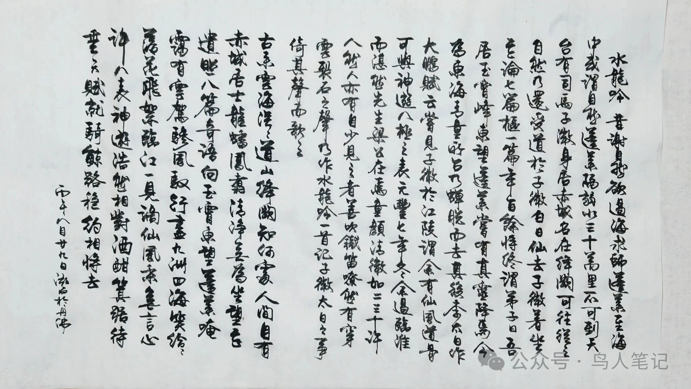

# 苏东坡，司马子微，和坐忘论

最近的一个小毛病，每天抄完经，还会再写一段苏东坡，算是自己日课后的消遣。

读多了东坡的文字，心里多少有点数：他老人家一辈子写得最多的，是儒家的坦荡、佛家的旷达。乌台诗案后的文字里道家的哲思渐浓，但直书道家的义理，在他所有作品里特别少见、算是非常冷门的题材。

前两天写到他的《水龙吟·古来云海茫茫》，写的是道家修行和仙者风骨，这已是难得。更有意思的是百字的水龙吟，竟有两百多字的长序，是他一生所有词作里序作最长的一篇，远超《水调歌头》《洞仙歌》这些名作，活脱脱是一篇完整、独立的小品散文。

一般东坡的词序，只是交代当下场景：宴饮、夜游、怀人、记事。唯独这一篇，大半篇幅都在梳理千年典故：谢自然求师、司马承祯著《坐忘论》、江陵遇李白、仙风道骨相惜的旧事。

能让东坡不惜笔墨，写下自己毕生最长的词序，专门为司马承祯、为“坐忘”二字落笔，足以见得这套道家心法，在他心里有点分量。

AI时代，查资料不要太简单，懒的理由都不复存在，顺着这份文字因缘，把《坐忘论》重新翻出来，认认真真通读了一遍。

以下是不加打磨的读后感，加上自己的胡乱联想，时事八卦，信口开河甩在键盘上，算是一段记录。

简单粗暴：两千多年，老庄释迦牟尼以降，所有修心做人的道理，似乎没啥新鲜东西。

人世间所有的纠结、执念、内耗、得失、怕死怕苦、人情世故，古人早就看得明明白白、说得干干净净。后来历朝历代，不管是哲学家、高僧高道，还是现在满天飞的心灵鸡汤鸭汤，说穿了，统统都是在“炒冷饭”。

时代一直在变，生活方式一直在变，但人性一点没变。人永远会贪、会纠结、会比较、会放不下、会害怕失去、会被琐事累得心烦。

阳光之下没新鲜事，人心的病根万变不离其宗，从来都是这么几个，那对应的解药，自然也不会变。

只是老庄的道理，太高级、太超脱了。站在山顶看世界，格局极大、境界甚纯，几句话就把天地人生讲透了。看着超级通透、特别潇洒，让人顿悟完拍拍脑袋，但有个问题：咋才能落地？

普通人要过日子，要应付人情往来、琐碎杂事、衣食生计，躲不开烟火气。只看老庄，看得懂意境，学不到实处，道理再高明，也落不进自己的生活里。

而司马承祯的《坐忘论》，除了文采飞扬，最可贵的地方就在这儿：他没有发明任何新道理。断缘、简事、收心、真观，所有核心内容，溯源全是老庄本来就讲透的东西。但他把老庄云端上的大道，拉回人间，掰碎了、讲白了，捏成普通人日常能用、听得懂、做得到的修心方法。

老庄讲无为、寡欲、逍遥齐物，是大境界；司马承祯直接告诉你生活里怎么用：

- 不用刻意避世，该过日子就过日子，衣食生计是渡世的船，没必要刻意舍弃；
- 不用强行断绝人情，别人热闹攀缘，我不主动凑、不跟着附和，旧缘慢慢淡、新缘不瞎结，就是断缘；
- 分得清什么是活命必需、什么是多余贪欲，敢删琐事、敢减欲望，就是简事；
- 遇到穷、病、得失、爱恨、生死恐惧，懂得回头观照自己的心，不被外境牵着走，就是真观、就是安心。

全篇都是大白话、实在话，没有玄乎的说教，句句对应普通人的烦恼。

千古以来，大道的根从来没变过。变的，只是每个时代的外壳和说法。古人烦恼功名乱世，今人焦虑职场内耗、攀比浮躁。烦恼的样子换了，但人心的贪执、不安、放不下，一模一样。

老庄定的是“道的根本”，万古不变；后世所有大德、高道、智者，做的是“道的活用”，对症时代的各种各种人心。

儒教教人立身做事，佛教教人放下释怀，而《坐忘论》这套心法，是贴上普通人烟火日子、让凡人们日常安心的路数。

忽然就想起最近网上炒的沸沸扬扬的各种大师的崛起和破灭，开悟解脱发财和智商税上当受骗的各说其词。

说白了，就是认知境界和信息差。

绝大多数普通人，不会花时间啃古文原典，不会逐字读老庄、读经论，更没精力梳理几千年的义理精髓，再去结合自己的生活和社会环境去演绎出破解烦恼的办法。

心里烦、心里乱，想要一个简单直接的答案，那种最好能一夜勘破凡尘苦，睁眼家财已万贯的捷径。

于是历代的智者、包括现在的心灵导师，太多的太多，做着大家都乐见喜闻的事：

把古人早已讲完的真理，从浩瀚典籍里挑出来、揉碎了，结合时代语境，重新打包成当下人能消化的“新感悟”“新智慧”。

这本身没问题，智慧本来就需要有人转述、有人普及，普通人也需要心灵出口。无对无错，一切都是因需求而生的产物。好玩的是，境界和认知的提升过程从来不是掏钱充值那么简单。

能借着这层信息差，把所有人共有的古老智慧，包装成自己的独门心得，然后顺势得名获利，真的是需要智商和能力的。而能否能从这些心得中发现自我和提升精神乃至物质境界，不仅仅是各自的造化，其实更需要智商和能力。

世人代代有烦恼，就需要代代重新听一遍、学一遍、悟一遍，活一遍。仅此而已。

——

顺着东坡、司马承祯与李白这段千古交集，也顺带读懂了我自己长久以来的一点私心偏好。

坦白说，我从来没有特别爱李白的诗。水平和认知有限是主要原因。虽然听说从文人才情、文学造诣来讲，李白是千古独一档的顶级人物，可若是抛开文人滤镜，单纯我满满的俗人心态去读他、感受他，始终会觉得隔着一层，完全够不着。

这哥们太仙了，仙得不接地气。他的世界永远是长风万里、明月九天、寻仙访道、恣意狂放，全程云里雾里、凌空蹈虚，几乎脱离了人间烟火的所有琐碎与困顿。他没有世俗的烦恼，没有生活的内耗，不被人情牵绊，不为生计忧心，永远游离在现实世界之外。

正因如此，他的浪漫虽极致绝美，却很难让俗不可耐的我共情。混迹红尘，一日三餐，世间百态、琐碎俗事、得失悲欢。凌空高悬的仙境诗意虽好，但不由自主的更被能落地、可安放、贴人心、渡日常的处世心法吸引。

这也是我偏爱东坡、会认真读《坐忘论》的原因。

废话一堆，有的没的，自己拎清自己是啥想干啥能干啥，再引一段司马子微的话：

> 若不簡擇，觸事皆為，則身勞智昏，修道事闕。若處事安閒，在物無累者，自屬證成之人。若實未成，而言無累者，誠自誑耳。

原文来源：<https://mp.weixin.qq.com/s/CFINKnjqbJB4rsc5iJDMdg>
