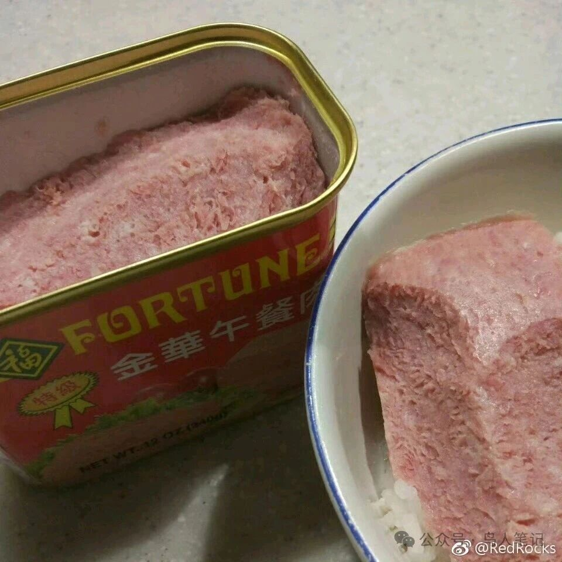
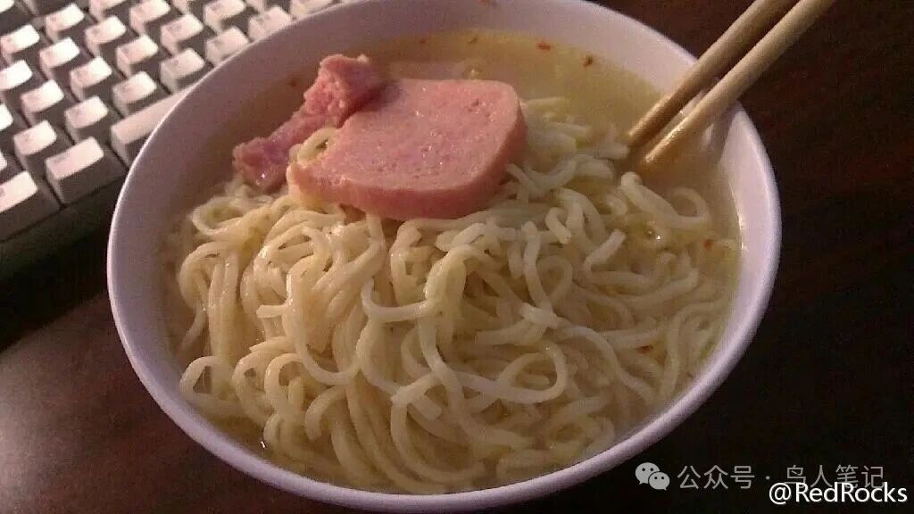
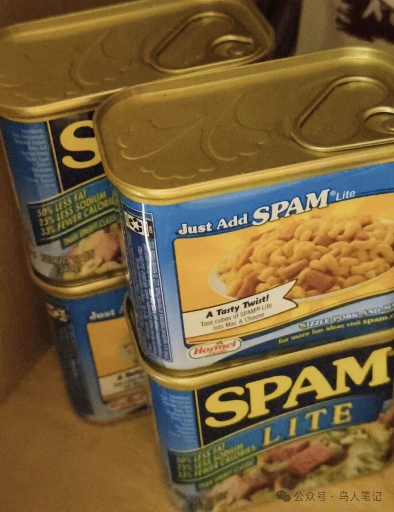

# 半个世纪的午餐肉

偶然被友人问起：是否爱吃午餐肉。简简单单一句闲话变成一只无形的手，一把扯开了尘封数十年的时光帷幕。种种旧事琐事纷纷涌上心头。

顺手检索早年微博，零零散散，竟有 N 多条字句为这罐头所写。不知不觉间，一罐午餐肉，似乎封藏了半生的记忆。

六七十年代的上海，那是个物资匮乏、万事凭票的年代。衣食住行，柴米油盐，没有一样是可以随心所欲的。那时上海居民的肉供应，每人每月有半斤生肉指标。区区半斤肉，便是一整月所有的油水盼头。

凭票供应并不意味着那个时代标榜的公平，有票便有肉。经历的人懂，纸面上的规则从来抵不过人间的人情与权衡。

权与阶级不论，只说实打实的生活。肉票只限定数量，并不规定肥瘦、部位、新鲜。当年案板操刀卖肉的，拥有的是最底层、最接地气也最最实在的权力。同样半斤定额，会来事、有人脉、懂人情世故的市井人家，就能切到肥瘦相间的好肉、新鲜的腿肉；而那些拘谨木讷的知识分子、旧时小户人家、带着海外关系，或是身份敏感的普通百姓，纵然攥着珍贵的肉票，也往往只能分到满是肥膘、带骨杂碎的次货。

那是很无奈的时代写照。后者这群夹着尾巴做人的人多少略有积蓄、甚至可能有比小市民尚可的一点收入，甚至手头有旁人没有的现金，却不懂市井的圆滑，也许可能有点点不屑，也不会经营柜台的人情往来。守着有限的肉票，拿到最差的肉，每月微薄的油水，还要被质量折损大半。日常饮食清苦寡淡，想要给生活添一点荤腥滋味，几乎别无选择。

于是，不占肉票、价格昂贵、无人可以拿捏的罐头熟食，就成了这一群人的补偿。

梅林午餐肉、红肠、方腿，这类熟食，脱离了计划供应的体系，不用排长队看人脸色，不用托人求关系，只要有钱就能买到。午餐肉罐头的肥瘦配比固定，口感稳定，开罐即食，不必面对切肉师傅随意的裁量。在那个处处受限的年代，这一罐小小的午餐肉，就从油水补充的吃食，升华成一份体面、一份从容，是普通人用钱换来的、不用看人脸色的温饱与欢喜。

也正因如此，在六十、七十年代，能常吃梅林午餐肉的家庭，大致家境宽裕。它不是平民日常的粗茶淡饭，是物资紧张年代难得的“奢侈品”，是属于那个特定时代、特定人群的温柔念想。

时隔数十年，想起当年采买的画面，依旧历历在目。

那时候的上海市第一食品商店在南京路，如今最黄金的地段，紧挨着市百一店。店堂开阔，人声滚滚，和街头小副食店的气象全然不同。要找熟食和罐头，不能在门口柜台逗留，得往深处走，有两级台阶往下，熟食柜台就设在台阶那里，阴凉干爽，玻璃柜里整齐摆着红肠、方腿与各式卤味，是童年里最勾人的香气。我们总是先下台阶挑选熟食，再转到罐头柜台去买梅林午餐肉。

父亲有一只黄绿色帆布军挎包，就是专门为这趟采购准备的。包的厚薄深浅，仿佛是为午餐肉量身做的，几罐整齐排开，稳稳当当，不会磕碰晃动。每周背着它去市百一店，装回来的不只是罐头，是一家人一整周珍贵的油水。这只挎包如今还留在上海老家，布面磨得发软，边角泛旧，装着一整段柔软的童年。还有一只全新未启用的，五十年后，安安静静在老去的箱子里，主人已然远去。

光阴倏忽，半世岁月转瞬即逝。辗转旅居异国，早年的华人超市，还能见到熟悉的上海梅林罐头，一口下去，就能唤起儿时上海的旧味。可世事变迁，不知不觉，疫情前后，正规进口的国产梅林慢慢从美国货架上消失了。种种检疫和贸易规则的限制，让这陪伴一代人的老味道，远隔重洋，无处寻觅。

找不到旧味，便只能在本地吃食里慢慢试错，慢慢寻找替代。

说来颇有一番世事反差的趣味。美国的 SPAM 午餐肉，原本是二战时期的军供物资，战后流入民间，向来是当地普通百姓的平价吃食，绝对和精致美味毛线关系。试了好几个版本之后，屈尊 SPAM Lite，算是最合口味。少油少盐，褪去原版厚重的油脂，正好契合了年岁渐长之后的饮食习惯。

它终究不是记忆里的梅林，没有老上海罐头独有的时代风味，却风云际会地接住了半世纪的情怀。

年少的时候，我们贪恋一罐午餐肉的油水香甜，用它填补物资匮乏的缺憾；年纪大了，执着于相近的口感，怀念的从来不是食物本身，而是那个艰难岁月里，难得的温暖与期盼。

一饭一食，藏着岁月浮沉。一罐寻常午餐肉，穿过第一食品商店的老台阶，装过父亲的军用挎包，跨过半世时光，越过万里重洋。从年少稀缺的珍味，到暮年随手可得的吃食，味道在变，时代在变，唯独藏在味蕾深处的旧记忆，从未褪色。

原来世间所有的执念，终究不是恋物，是怀旧，怀念那个简单的年代，和那个为一口荤腥满心欢喜的自己。

---

原文发表于公众号「鸟人笔记」。
