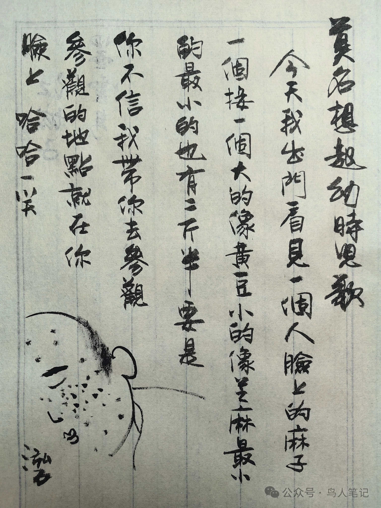

# 城南旧事：儿歌勾起的回忆

莫名其妙，脑海里忽然泛起幼时的一曲无厘头儿歌：

> 今天我出门，看见一个人，脸上的麻子一个接一个，大的像黄豆，小的像芝麻，最小的最小的也有两斤半，要是你不信，我带你去参观，参观的地点就在你脸上。

想来是儿时不讲究政治正确的恶作剧出品，也不知道是不是还有人记得。涂出来，以记。面有微疵的朋友勿怪。

———

## (1)

朋友贴了张江南水乡雨。空空的画面里，一个人也没有；高高低低的青瓦屋檐，断线珍珠般坠落了串串雨水。图下是这几句儿歌：落雨了，当烊了，小八拉子开会了……屋檐下的雨，屋檐下的童声，顿时唤起一串童年的回忆，雨水一样砸在心上，然后碎了，溅落一地。如逝去的童年，再难找回。

## (2)

这该是首地道的上海童谣了。从小长在上海弄堂里的朋友，现在稍微有点岁数的，该都极其熟悉这几句话的。我唱这童谣的时候，是在师大287号的日子。

287号是师大一村深处几排矮平房中的一间，屋檐很低，大人伸手就能摸得到。师大一村肯定是解放后建造的，在80年代初那种延续至今的6层火柴盒兵营公寓出现前，主体还都是一排排的瓦房。这片至今依然闻名上海的村落里，终于没有足够的时间去沉淀出江南水乡老屋那种自然的参差高低，但那时却继承了水乡建筑大斜顶低檐的建筑风格。屋檐远远挑出弄堂，梅雨的季节，行人如果忘记了带上把油布伞，就可以侧了身子在屋檐下躲雨或者慢慢往家走，尽管屋檐的功能比不上广州的骑楼能让行人完全躲开风雨的暴虐，但多少可以让人避免落汤鸡的狼狈。

而那年代的童年，是没有太多五光十色的娱乐的。除去几部看烂的电影外，剩下的娱乐都是在大自然的赐予里取得的。下雨，自然属于最让孩子们开心的时候。大声嚷嚷着这首童谣，光了脚丫在弄堂里跑来跑去，吧唧吧唧地把水溅得到处都是。大人们在门里窗内，也在大声嚷嚷着。父母担心孩子着凉，邻居抱怨孩子太吵还把脏水溅到门窗上。

## (3)

师大在苏州河边，文革中的三结合，使得船民、老师、工匠都彻底打乱了他们的社会分工和曾经的社会层面。大家都是一样的人，大家都有善良的心。这让我到现在看到衣冠楚楚把服务员呼来喝去的大爷们，都会想到那个疯狂而又简单的年代。

孩子们都在一起上学，每人带来自己的方言。于是东北话、广东话、上海话、苏北话，在小小的课堂里有机地融合成了一个崭新的师大一村话。这也许是全中国最独特、使用人数最少、存在时间最短的方言。现在去师大一村，已经再不能听到那种奇怪的发音了。

而这方言转换下的童谣，也带上了鲜明的地方特色。第一句的“落雨了”，成了普通话的“下雨了”；第二句照搬上海话发音，“当烊了”；而最后一句“小八拉子开会了”却揉进了船民的苏北口音，成了“小波罗头子开会了”……

## (4)

上海的大人们自然是不会有失身份地冲到雨里和孩子们理论的。于是唱着童谣的孩子尽可以肆无忌惮地捣乱。我那时最爱的是用小手捧来泥土建成一道泥坝，把下水沟堵上，看雨水在坝后一点点涨起来，然后形成一个小小的瀑布。水流会松动泥坝，于是又得光脚在雨水的石板路上吧唧吧唧地跑去捧来更多的土抢险。

泥坝最后一定是输给雨水的，哗啦一下冲垮了，冲进下水道。而那往往带来没有预想到的后果，就是真的把下水道堵了，水漫得到处都是。于是只好蹶了小屁股蹲在雨水里，细细的小胳膊使劲撑进下水道去掏，等鼻子快凑到臭水面的时候，阴沟通了，水打了旋而呼啸直下。那就是该甩了两只脏脏的小手回家的时候了。爸爸妈妈都下乡去了，只有姥姥在。姥姥从来都是护着我的，绝不会说我把自己搞得泥猴一样。急忙地找干衣服给我换上，或许还有碗加了糖的热姜汤。

## (5)

这次回从上海离开时，儿时的邻居哥哥建平来送我。建平是阿三爸爸的大儿子，我们两家该有半个世纪的交情了，这友谊从父辈们开始延续到现在。初次相逢的时候，父母们都还三十不到，而阿三爸爸已经在几年前去世了，建平哥哥也快50了，长得和记忆里的阿三爸爸一模一样。

那天我们两个开了车在师大校园里转了半天，找孩子时候的痕迹，师大的文史楼依然在那里。三十年前，那顶楼是锁上的。我们从边角爬上楼顶。四楼在那时孩子的眼里是绝对的高楼了，可以放眼看到很远的地方。校长办公室是在丽娃河——那时当然不能叫这个很小资的名字，俗名是叫老河滨，用师大一村话读就是老河梆了——畔，那时是个两层的小楼，现在依然是，历尽了老校长、造反派、工宣队、军宣队、改革办、新校长……看样子当官的喜欢这种独特的精致，与众不同。

我们在师大门口的小店里吃的早饭，素鸡和白斩鸡加白粥，聊聊了我们的童年、父母们的中年和老年，和我们的孩子们的童年……然后我们开车去机场，一路继续聊着聊着。然后我们发现我们走到了乡间的小路，肯定赶不上我的航班。乡间的路，和我们的童年记忆居然有几分的相似。

## (6)

我们都笑了，童年的故乡，是不该这么来去匆匆的。打电话，把机票换到了后天，然后回到师大，再次坐在阿三爸爸在20多年前打的那张沙发上，抽烟。我走出师大的门口，在校门边的小店里烫了半斤黄酒，暖暖地喝着。

童年早已过去，美好只存在记忆中。只在偶然见到的孩子时的玩具，或者一个标记，或者一句儿歌中，从记忆的深处浮出。那天我没有和往日一样去找在上海的朋友们吃喝玩乐，把自己关在老屋里，想再体会一下昨天。到入夜的时候，我知道自己失败了。没有了亲人的家，只是一间冰冷的房间。第二天一早，我拨通了航空公司的电话，一刻也不想多停。赶上了下一班离开的飞机。

新机场在浦东，曾经只有一个浦东公园的地方。现在汽车驶过巍峨的卢浦大桥后还开了40分钟才到机场。起飞，立刻看到的就是东海。机翼下是点点的船影。上海的早晨，雾气蒙蒙。陆地渐渐在朦胧中消失。关灯，闭目，心里有一丝寒意。那一刻我知道上海正在我心中淡去。

## (7)

然后我又见到了江南水乡的照片，那高低参差的屋檐，那屋檐下串串而下的水珠……我又听见了童年的歌声。

> 落雨了，  
> 当烊了，  
> 小八拉子开会了……

泓石 REDROCKS／2004
