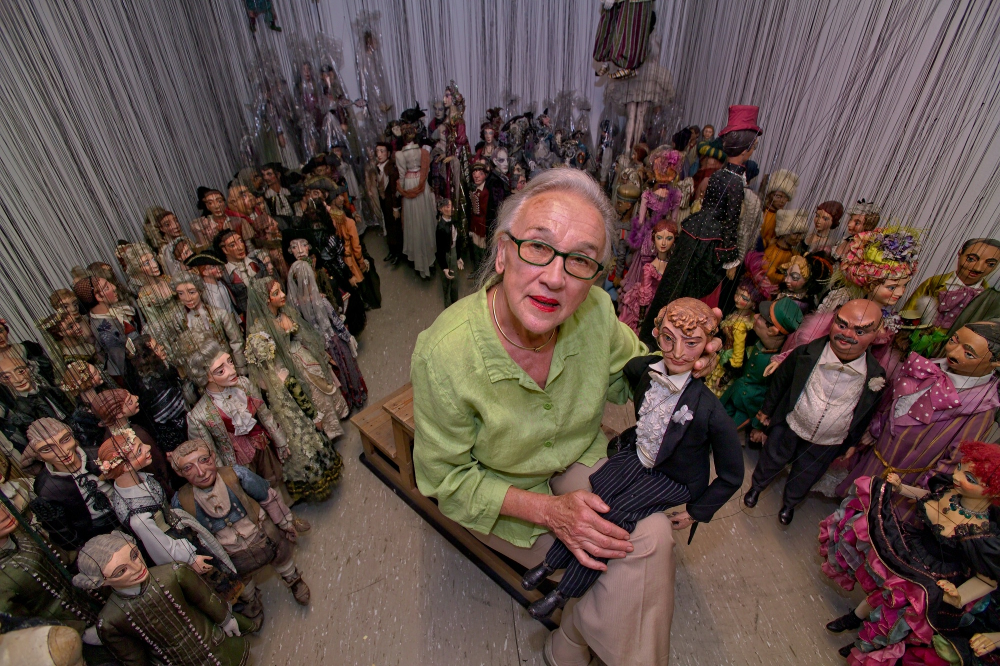

# 她的孩子们

*——迟到了二十二年的问候*

2004年，我和搭档H来到奥地利萨尔茨堡。我们带着《时尚旅游—National Geographic Traveler》的采访任务，这次的采访地点，是当地一家有着近百年历史的木偶剧院。

那次采访的主人公，是一位名叫 Gretl Aicher 的老太太。

她出生于1928年，祖父 Anton Aicher 于1913年创办了萨尔茨堡木偶剧院，父亲接过祖父的事业，后来又传到了她的手中。三代人，几乎一整个世纪，与那些悬挂在细线上的木偶相伴。

采访是在剧院的道具间里进行的。

那是一间满满当当的屋子。四周挂满了木偶，国王、贵族、少女、士兵，还有各种说不上名字的人物，穿着不同时代的服装，密密麻麻地挤在一起。无数细线从头顶垂下来，牵引着那些木头做成的胳膊、腿脚和脑袋。

她就坐在这些木偶中间，和我聊天。

她一辈子都在这家剧院里工作，终身没有结婚，也没有自己的孩子。说起那些木偶，她的神情温柔得像一位母亲。

很感人。但不知道为什么，我心里又有那么一点点伤感。

我当然没有理由替她的人生感到遗憾。她有自己热爱的事业，有一个庞大的木偶家族，也许比许多拥有真实家庭的人活得更加充实。然而，看着眼前这位白发苍苍的老太太，温柔地抱着一个永远不会长大的木偶，心里还是隐约泛起了一丝说不清的滋味。

听完她的故事，我觉得应该给她和她的孩子们拍一张照片。

屋子里恰好有一架梯子。征得允许后，我把梯子搬过来，爬了上去。

我没有移动她，也没有调整任何一个木偶。采访时，她坐在道具室地上的一堆木箱上，怀里抱着她的孩子。不需要任何摆拍和调整，我只是想找到一个角度，让她成为画面的中心，让那些陪伴了她一辈子的孩子们环绕在四周，不要有任何多余的视觉干扰。

她坐在那里，用手托着木偶的头，让他舒舒服服地坐在自己的怀抱里：

**“你看，这就是我的孩子，他们都是我的孩子。”**

我按下了快门，至今仍记得她说出这句话时的神情。

拍摄的时候，我们一直在聊天。她抬起头看着高处的我，也就自然地望向了镜头。

我按下了快门。

那一瞬间，她坐在自己的世界中央，怀抱着一个孩子，周围是几十个大大小小的木偶，一个热闹的大家庭。

我拍下的不是一位木偶剧院的负责人，一位著名的艺术家，而是一位母亲，和她的孩子们。

那次采访结束后，我继续往前出发。

作为旅行摄影记者，那些年几乎一直在路上。一个地方接着一个地方，一次采访接着一次采访。认识新的人，听新的故事，拍新的照片。那些刚刚发生过的事情，很快又被下一段旅程覆盖。

一次又一次地翻页。

萨尔茨堡的那间道具室，和那位抱着木偶的老太太，也就这样渐渐沉入记忆深处。

偶尔还会想起她。

特别是她说出“他们都是我的孩子”时，我按下快门的那个瞬间。

但也仅此而已。

后来我再也没有回去看过她，也没有打听她的消息。生活就是这样，曾经短暂交会的人，告别之后，各自沿着自己的路继续往前走。谁也不知道还有没有重逢的机会。

转眼二十二年过去了。

2026年，我也已经退休。几十年的摄影生涯，走过无数地方，采访过无数的人。那些曾经在镜头前与我交谈、欢笑、沉默的人，如今都怎么样了？有些人也许依然生活在原来的地方，有些早已远走他乡，也许还有很多，已经不在人世。

最近重新翻看当年的老照片，又看到了她。

她仍然坐在那里。

白发，眼镜，怀里抱着那个木偶。周围那些花花绿绿的孩子们，仍然挤满了整个画面。她抬起头，望着二十二年前站在梯子上的我。

照片里的她，还是2004年的模样。

我忽然很想知道，她后来怎么样了。

于是对着照片，问了AI一句：

**“她还好吗？”**

没想到，这个迟到了二十二年的问候，带回来的是她已经离去的消息。

Gretl Aicher 于2012年3月14日去世，享年83岁。

那已经是十四年前的事情了。

更让我感慨的是她生命最后的故事。

据当年的报道，去世前一天，她仍然在剧院参加排练。第二天身体不适，被送往医院的时候，还惦记着剧院的工作，想回去继续排练。

直到生命的最后，她依然和她的孩子们在一起。

我又去查了那家木偶剧院的消息。

剧院还在。

1913年由她祖父创办的萨尔茨堡木偶剧院，经历过三代人的经营，也经历过她去世后的财政困境，最终还是保存了下来。她没有留下自己的子女，但那些木偶和木偶背后的艺术，有了新的继承者。

2016年，萨尔茨堡木偶剧院的传统提线操纵技艺，被列入奥地利国家非物质文化遗产名录。直到今天，剧院依然在演出，依然有人制作木偶、操纵木偶，带着它们走上舞台，甚至远渡重洋巡回表演。

她的孩子们还在。

知道这个消息，心里有些欣慰，也有些说不清的感慨。

回头看看这几十年的摄影生涯，突然觉得，那些老照片所留下的，远不只是山河风景、历史建筑，或者某个地方的风土人情。

更多的是人。

一个个曾经鲜活的人，生命中普通的一个瞬间。

对于他们而言，那也许只是平常的一天。一个下午，一次闲聊，一次偶然的相遇。他们不知道自己会在某个人的底片上留下一个影像，更不知道几十年后，还有人会从旧照片里认出他们，想知道他们后来的人生。

而我，当年只是一个匆匆路过的摄影记者。

我曾经走进他们的生活，短暂地听过他们的故事，然后告别，继续上路。他们则留在原来的地方，继续各自的人生。

我们之间的交集，也许只有那么一两个小时。

照片却把这个瞬间留了下来。

二十二年前，我爬上一架梯子，拍下了一位老太太和她的孩子们。

二十二年后，我终于知道，她已经走完了自己的一生，而那些孩子们还在继续她的故事。

我不知道当年那间道具室如今是什么模样，也不知道照片里究竟有多少木偶还留在那里。也许有一天，我会再去一趟萨尔茨堡，看看那座剧院，看看她留下的孩子们。

至于她，我已经不可能再见到了。

但在我的照片里，她仍然坐在那里，温柔地抱着怀里的木偶，抬头望着我。

仿佛我们之间的那场聊天，从来没有结束。

*2026年11月，重看2004年摄于萨尔茨堡的旧照。*
